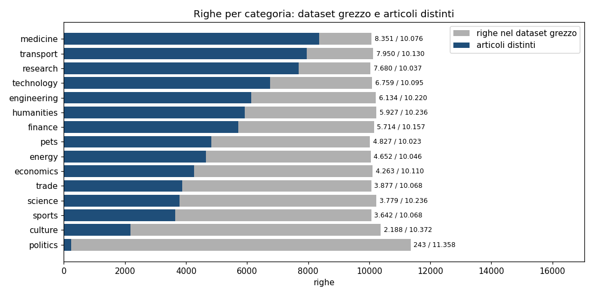
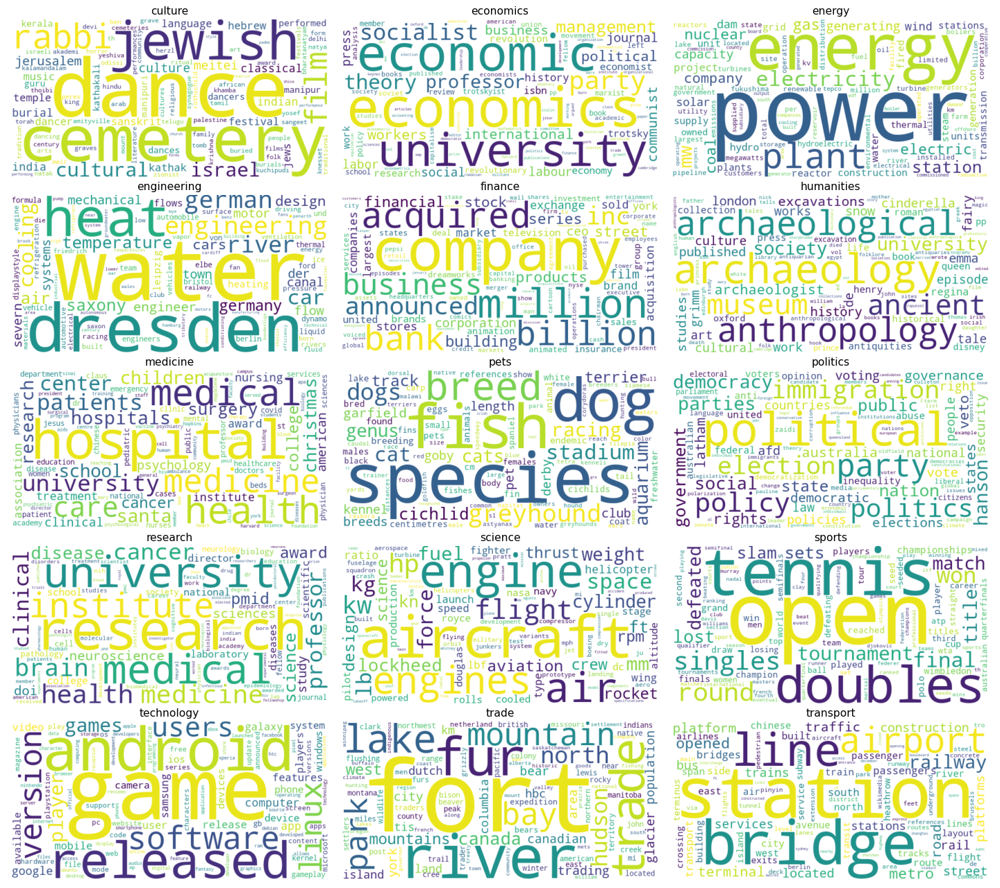
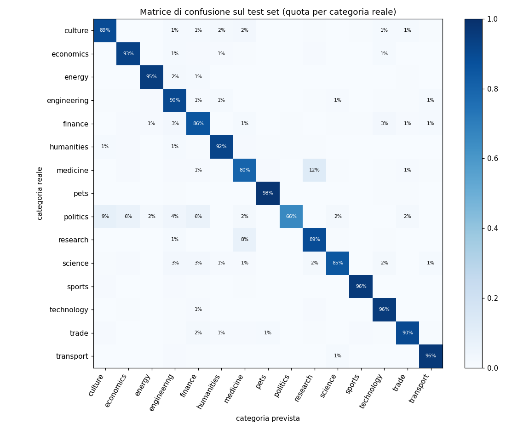

# Analisi di Wikipedia
Questo progetto si prefigge di ottimizzare l'analisi e la categorizzazione dei contenuti di Wikipedia, attraverso la data analysis e il machine learning. L'obiettivo principale è comprendere meglio il vasto patrimonio di contenuti informativi offerti da Wikipedia e sviluppare un sistema di classificazione automatica che consenta di categorizzare efficacemente i nuovi articoli futuri.

# Servizi e librerie utilizzati
- <strong>AWS S3</strong> (servizio cloud di archiviazione a oggetti), da cui viene scaricato il dataset
- <strong>Databricks</strong>, piattaforma di Data Intelligence basata su un data lakehouse, ovvero un'architettura dati moderna che unifica le capacità di un data lake e di un data warehouse in un'unica piattaforma, offrendo flessibilità e scalabilità per dati strutturati e non [https://www.databricks.com/]
- <strong>Apache Spark 3.5</strong> (PySpark), con le librerie per query SQL ed elaborazione distribuita e <strong>Spark ML</strong> per il machine learning
- <strong>Pandas</strong> per i risultati aggregati e <strong>Matplotlib</strong> per i grafici
- <strong>WordCloud</strong>, libreria per la creazione delle nuvole di parole
- <strong>Scikit-learn</strong> per il calcolo delle metriche di classificazione, <strong>pytest</strong> per i test

# Obiettivi del progetto
1. Analisi Descrittiva dei Contenuti
    - Il primo obiettivo del progetto è condurre un'<strong>analisi esplorativa</strong> dei dati (EDA) per capire le caratteristiche dei contenuti di Wikipedia suddivisi in diverse categorie tematiche, come ad esempio:
      - Cultura, Economia, Medicina, Tecnologia, Politica, Scienza, e altre.
    - L'analisi esplorativa prevede:
        - Il conteggio degli articoli presenti per ogni categoria
        - Il numero medio di parole per articolo
        - La lunghezza dell'articolo più lungo e di quello più corto per ciascuna categoria
        - La creazione di nuvole di parole rappresentative per ogni categoria, per identificare i termini più frequenti e rilevanti

2. Sviluppo di un Classificatore Automatico
   - Il secondo obiettivo è creare un modello di machine learning capace di <strong>classificare automaticamente</strong> gli articoli in base alla loro categoria, utilizzando il testo degli articoli:
       - Sommario (summary): introduzione breve dell'articolo
       - Testo Completo (documents): contenuto completo dell'articolo, che contiene già il sommario come primo paragrafo

3. Identificazione di Nuovi Insights
      - L'analisi consente anche di ottenere insights sui contenuti di Wikipedia, come la <strong>densità di articoli</strong> per categoria o le <strong>tendenze linguistiche</strong> associate a determinati argomenti. Queste informazioni possono aiutare Wikimedia a migliorare l'organizzazione delle pagine e a ottimizzare i propri sforzi editoriali.

# Repository
```
bigdata/
├── src/wikipedia/
│   ├── spark.py        # sessione Spark (locale o Databricks)
│   ├── data.py         # download, lettura con Spark, controllo di qualità, pulizia, split stratificato
│   ├── text.py         # tokenizzazione e stopword comuni a tutte le analisi
│   ├── analysis.py     # statistiche per categoria, parole frequenti e caratteristiche, indicatori linguistici
│   ├── wordclouds.py   # nuvole di parole
│   └── classifier.py   # pipeline Spark ML, confronto dei modelli, valutazione, previsione
├── notebooks/
│   ├── databricks_wikipedia.py   # notebook Databricks con l'intero progetto
│   └── risultati.ipynb           # notebook con tutti i risultati, già eseguito
├── images/                       # grafici e nuvole di parole (images/wordclouds/*.png)
├── tests/test_wikipedia.py
├── eda.py              # analisi esplorativa, insights e nuvole di parole
├── train.py            # addestramento e valutazione del classificatore
├── predict.py          # classificazione di nuovi articoli
├── requirements.txt
└── pytest.ini
```

# Utilizzo

### Su Databricks
1. Clonare il repository in Databricks: *Workspace → Create → Git folder*, con l'URL del repository.
2. Creare un Volume di Unity Catalog per dati e modello, per esempio con `CREATE VOLUME IF NOT EXISTS workspace.default.wikipedia`.
3. Aprire `notebooks/databricks_wikipedia.py`, impostare il percorso del Volume nel widget in alto ed eseguire tutte le celle.

Il notebook scarica il dataset nel Volume, esegue analisi e addestramento e salva il modello nel Volume.

### In locale
Serve Java 17 (richiesto da Spark) e Python 3.10 o successivo. Dalla cartella del progetto:
```bash
python -m venv .venv
.venv\Scripts\python.exe -m pip install -r requirements.txt    # su Linux/macOS: .venv/bin/python
.venv\Scripts\python.exe eda.py                                 # circa 3 minuti
.venv\Scripts\python.exe train.py --confronto-duplicati         # addestramento e valutazione
.venv\Scripts\python.exe predict.py --testo "The striker scored twice in the cup final."
.venv\Scripts\python.exe -m pytest                              # test
```
Al primo avvio il dataset (circa 1 GB) viene scaricato in `data/`. Tabelle e risultati vengono salvati in `reports/`, grafici e nuvole di parole in `images/`, il modello in `models/`.

<strong>Nota per Windows</strong>: Spark scrive file su disco solo se è configurato `HADOOP_HOME` con `winutils.exe`. Senza, analisi e addestramento funzionano (i risultati vengono salvati con pandas), ma il modello non può essere salvato e quindi `predict.py` non ha un modello da usare. Per salvare il modello conviene usare Databricks, Linux, macOS o WSL.

# Workflow
1. <strong>Caricamento</strong>: il CSV viene letto direttamente da Spark con `spark.read.csv` (`multiLine` ed `escape` delle virgolette, perché i testi contengono a capo e virgolette), senza passare da pandas: con 1 GB di dati caricare tutto in memoria sul driver vanificherebbe l'uso di Spark.

2. <strong>Qualità dei dati e pulizia</strong>: si rimuovono i duplicati esatti, i testi vuoti e i testi presenti con più categorie, e si tiene un solo articolo per testo.

3. <strong>Analisi esplorativa</strong>: per ogni categoria, numero e quota di articoli, parole per articolo (media, mediana, minimo, massimo), articolo più lungo e più corto.

4. <strong>Parole e nuvole di parole</strong>: il testo viene tokenizzato con `RegexTokenizer` (solo lettere, in minuscolo) e filtrato con `StopWordsRemover`, con la stessa procedura in tutte le analisi. Per ogni categoria si calcolano le parole più frequenti e le <strong>parole caratteristiche</strong>, frequenti nella categoria e relativamente rare nelle altre, che alimentano le nuvole di parole.

5. <strong>Classificatore</strong>: pipeline Spark ML
   - <strong><mark>RegexTokenizer → StopWordsRemover → CountVectorizer → IDF → classificatore → IndexToString</mark></strong>

   Lo split train/test (80/20) è stratificato per categoria. Vengono confrontati su un validation set ricavato dal training set:
   - regressione logistica con diversi valori di regolarizzazione e con <strong>pesi per classe</strong>: ogni articolo pesa in modo inversamente proporzionale alla dimensione della sua categoria, perché le categorie sono molto sbilanciate (`politics` ha 30 volte meno articoli di `medicine`);
   - per confronto, la stessa regressione logistica senza pesi per classe;
   - regressione logistica con la standardizzazione delle feature, impostazione predefinita di Spark: con il TF-IDF amplifica le parole rare e peggiora i risultati;
   - Naive Bayes, il modello classico per la classificazione di testi, e random forest, preceduta dalla selezione delle 2.000 parole più informative, perché con 50.000 feature sparse esaurisce la memoria.

   Tutti i modelli tranne quello di riferimento senza pesi usano i pesi per classe. Il modello finale è il migliore per F1 macro tra quelli con i pesi; viene valutato una sola volta sul test set e salvato come pipeline completa, che riceve direttamente il testo grezzo.

6. <strong>Insights</strong>: duplicazione e densità degli articoli per categoria, sotto-argomenti dominanti, indicatori linguistici (ricchezza lessicale e lunghezza delle parole).

# Risultati
Tutti i risultati sono calcolati con Spark 3.5 in locale sul dataset completo e sono riportati, con i grafici, nel notebook [`notebooks/risultati.ipynb`](notebooks/risultati.ipynb).

### Qualità dei dati
| | Righe |
|---|---|
| Dataset grezzo | 153.232 |
| Righe distinte | 75.986 |
| Testi vuoti | 463 |
| Righe con testi presenti in più categorie | 2.435 (1.192 testi) |
| <strong>Articoli dopo la pulizia</strong> | <strong>72.178</strong> |

<strong>Metà del dataset è composta da duplicati esatti.</strong> Il dataset grezzo sembra bilanciato, con circa 10.000 righe per categoria, ma è un effetto dei duplicati, distribuiti in modo molto diverso tra le categorie: `politics` ha 11.358 righe ma solo <strong>243 articoli distinti</strong> (98% di duplicati), `medicine` 8.351 articoli distinti su 10.076 righe.



### Analisi esplorativa
- Un articolo ha in media circa 780 parole, ma la distribuzione è molto asimmetrica: la mediana è 395 parole e pochi articoli molto lunghi (fino a 33.479 parole) alzano la media.
- `politics` ha gli articoli più lunghi (mediana di 1.130 parole), `pets` e `transport` i più brevi (mediana di circa 150–160 parole).
- Gli articoli più corti hanno poche parole e spesso non sono veri articoli: pagine di servizio come `wikipedia:wikiproject council/proposals/android` o elenchi come `companies listed on the new york stock exchange`.

Le tabelle complete (articoli e parole per categoria, articolo più lungo e più corto di ogni categoria) sono nel notebook e vengono salvate da `eda.py` in `reports/`.

### Nuvole di parole
Le nuvole mostrano le <strong>parole caratteristiche</strong> di ogni categoria, con un punteggio pari al conteggio nella categoria moltiplicato per il logaritmo del rapporto tra frequenza nella categoria e frequenza complessiva. Le parole semplicemente frequenti sono simili tra le categorie e non le distinguono: per esempio *references* (dal titolo della sezione delle fonti) è tra le 20 più frequenti in 10 categorie su 15, *world* in 7, *american* in 6.



### Insights
- <strong>Le categorie riflettono il modo in cui è stato costruito il dataset più che il significato del loro nome.</strong> `science` è dominata da articoli di aviazione (*aircraft*, *engine*, *flight*), `trade` dalla storia del commercio di pellicce in Nord America (*fort*, *fur*, *hudson*, *bay*), `engineering` da articoli su Dresda e la Sassonia, `sports` quasi solo dal tennis. Le categorie non sono quindi un campione rappresentativo dei rispettivi temi, e un classificatore addestrato su questi dati potrebbe sbagliare su articoli dello stesso tema ma di altri sotto-argomenti (per esempio il calcio per `sports`).
- <strong>Densità degli articoli</strong>: `transport`, `medicine` e `research` sono le categorie più coperte (9–11% degli articoli ciascuna); `culture` (3%) e soprattutto `politics` (0,3%) le meno coperte. Sono le categorie su cui concentrare la raccolta di nuovi articoli.
- <strong>Tendenze linguistiche</strong>: `humanities`, `pets` e `culture` hanno il lessico più vario, `energy` e `transport` il più ripetitivo, con molti termini tecnici ricorrenti. Le parole sono più lunghe in `politics`, `research` ed `economics` (linguaggio più astratto) e più corte in `sports`.

### Classificatore
Confronto sul validation set (11.550 articoli). Il *recall minimo* è il recall della categoria riconosciuta peggio, che è sempre `politics`:

| Modello | Accuratezza | F1 macro | Recall minimo |
|---|---|---|---|
| <strong>Regressione logistica (regParam=0.01)</strong> | <strong>0.908</strong> | <strong>0.892</strong> | <strong>0.676</strong> |
| Regressione logistica (regParam=0.001) | 0.903 | 0.888 | 0.676 |
| Regressione logistica (regParam=0.1) | 0.898 | 0.879 | 0.676 |
| Regressione logistica senza pesi per classe (riferimento) | 0.906 | 0.892 | 0.541 |
| Regressione logistica con standardizzazione (impostazione predefinita di Spark) | 0.868 | 0.846 | 0.541 |
| Naive Bayes | 0.849 | 0.835 | 0.635 |
| Random forest (2.000 parole) | 0.733 | 0.701 | 0.432 |

Tutti i modelli tranne quello senza pesi usano i pesi per classe.

Valutazione finale del modello scelto, regressione logistica con pesi per classe, sul test set (14.440 articoli):

| | Accuratezza | F1 macro | Recall di `politics` |
|---|---|---|---|
| <strong>Dati puliti</strong> | <strong>0.908</strong> | <strong>0.891</strong> | <strong>0.660</strong> |
| Stesso modello valutato come nel progetto originale (dati con duplicati, split casuale) | 0.945 | 0.944 | – |

- Con i duplicati il <strong>65% degli articoli del test set è già presente nel training set</strong>: l'accuratezza del 94,5% misura in buona parte la memoria del modello, non la capacità di classificare articoli nuovi. Il valore realistico è il 90,8%.
- I <strong>pesi per classe</strong> lasciano invariate accuratezza e F1 macro, ma aumentano il recall di `politics`, la categoria più piccola (233 articoli), da 0,54 a 0,68 sul validation set. Sul test set l'F1 di `politics` è 0,63 (precisione 0,60, recall 0,66): resta la categoria più difficile, ma il modello ne riconosce due articoli su tre invece di uno su due.
- La standardizzazione delle feature, attiva per default in Spark, fa perdere 4 punti: con il TF-IDF porta le parole rare sulla stessa scala di quelle frequenti e ne gonfia l'influenza.
- La random forest è nettamente peggiore: i modelli ad alberi non sono adatti a decine di migliaia di feature testuali sparse.
- Gli errori più frequenti sono tra `medicine` e `research` (185 articoli di `medicine` classificati come `research` e 103 nel senso opposto), perché molti articoli parlano di ricerca medica.


